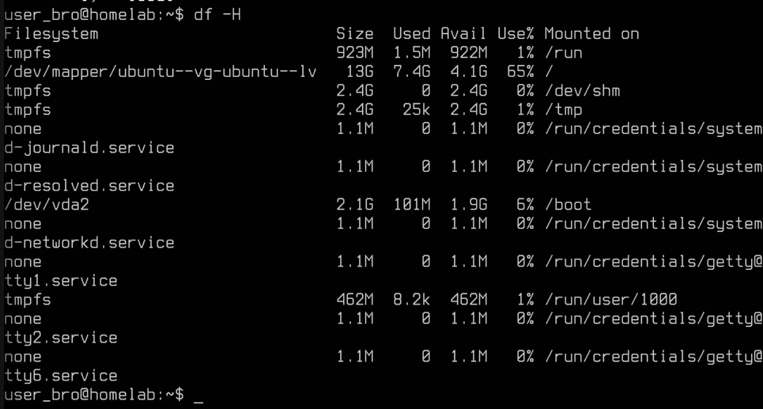
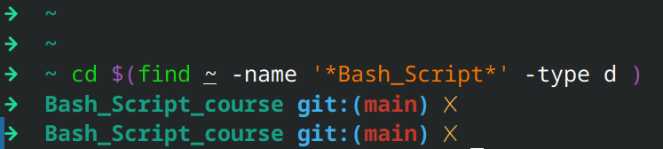

### Current system info   as of Nov 2 , 26 
- fedora 42 
- 


## 2026-11-02 22:47
- installed a virtual 

### Linux 
- update debian based 
`sudo apt-get update && sudo apt-get upgrade -y `  
- command to check the ip address of current system 

- find ip of virtual machine 
https://www.geeksforgeeks.org/linux-unix/command-to-check-ip-address-in-linux/
` hostname -i  `


- Ip address : 192.168.122.203 


## TASK 2 : Copy ip address from virtual machine to here 

## TASK 3 Increase font of virtual  machine server 

- https://askubuntu.com/questions/1402246/how-change-the-font-size-in-ubuntu-server-20-04-lts

` sudo vi /etc/default/console-setup FONTFACE="Terminus" FONTSIZE="16x32" sudo update-initramfs -u sudo reboot `

## TASK 4 :  Check disk usage 

- `df -H `


- https://opensource.com/article/18/7/how-check-free-disk-space-linux

## Task 5 : ssh into the homelab 
- Public ip of  current system and home lab 
  - -   `curl ifconfig.me `  
    Why not `hostname -i ` 
    - - 
- command of ssh to connect 
  - - 


## Task 6  : cd into project directly 
- `cd $(find ~ <name>  -type d task6.img`
- Explain the command : 

 


## Task 7 : How to view markdown code in vim/nvim 
- 
## Sub Task 8 : word wrap in nvim 
- https://dev.to/cbartlett/word-wrapping-in-vim-4oog 
-  Press i to get in normal mode and then Press : , Type `:` then  ` set word   `

## Task 9 : How to paste images in nvim and it gets added to directory like VS code 

## Task 10 : Create Github repo from CLI 
- `gh repo create web_scrape --public`


# Linux 


## Task 1 : fd command error 
- ```  

~ fd -t f '*Handy*' 
[fd error]: regex parse error:
    *Handy*
    ^
error: repetition operator missing expression

Note: You can use the '--fixed-strings' option to search for a literal string instead of a regular expression. Alternatively,
 you can also use the '--glob' option to match on a glob pattern``` 


### Bash Script 

1. as a Way to get most recent screenshot be moved to the current project working on to add it into git repo 

2. download folder  clean up script 

3. suppose your system will be smashed in next 5 minutes , write a script to get all the dotfiles and config files to recreate the customise system 

4. 


# Git 


## task g1 : 


< 

- whats wrong , why , and how to fix it 

## task g2 : 

< 


- whats wrong , why , and how to fix it 


